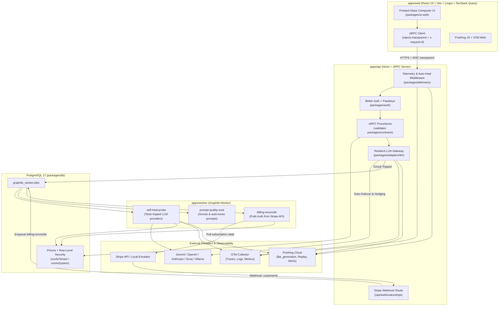

# OpenPrompt OS — Low-Level Design & Monorepo Architecture Plan

> [!IMPORTANT]
> This architecture is tailored for **OpenPrompt OS** as a zero-employee, self-healing open-source SaaS monorepo. Mobile and desktop targets are excluded to keep the surface strictly focused on Web (`apps/web`), API (`apps/api`), Worker (`apps/worker`), and modular workspace packages (`packages/*`).

---

## 1. Confirmed Architectural Decisions

| Area | Decision |
| :--- | :--- |
| **Monorepo & Tooling** | `pnpm` workspaces + **Turborepo** (`turbo.json`), **TypeScript** everywhere (`tsconfig.base.json`), **Biome** (`biome.json`) for lint/format, **Vitest** for unit/contract/integration tests. |
| **Frontend (`apps/web`)** | **React 19**, **Vite**, **Tailwind CSS v4**, **React Router v7**, **TanStack Query v5**, **oRPC Client** (`@orpc/client` + `@orpc/tanstack-query`), **Lingui i18n**, **shadcn / Base UI** vendored in `packages/ui-web`. |
| **Backend (`apps/api`)** | **Hono** + **oRPC Server** (`@orpc/server`) backed by **Zod v4** contracts (`packages/contracts`). |
| **Authentication (`packages/auth`)** | **Better Auth** (`better-auth` + `@better-auth/passkey`) with passkey support, session management, and automatic default `Space` provisioning. |
| **Database (`packages/db`)** | **PostgreSQL 17** + **Prisma** (`@prisma/client` + `@prisma/adapter-pg`) with connection-level **Row-Level Security (RLS)** (`runAsTenant` / `runAsSystem`). |
| **Background Jobs (`apps/worker`)** | **Graphile Worker** (`graphile-worker`) on PostgreSQL with correlated job tracing and in-memory queue fallback for tests. |
| **Payment & Billing (`packages/adapters/billing`)** | **Stripe** (`StripeBillingProvider`) + **Zero-Config Local Billing Emulator** (`LocalBillingEmulator` for offline dev/tests). Uses `rakazo`'s pull-based webhook reconciliation pattern. |
| **LLM Gateway (`packages/adapters/llm`)** | Provider-agnostic `LlmGateway` supporting **Gemini**, **OpenAI**, **Anthropic**, **Groq**, **OpenRouter**, **Ollama**, and a zero-downtime deterministic **Rule Synthesizer** fallback. |
| **Observability & Auto-Healing (`packages/telemetry`)** | **OpenTelemetry** (Traces, Logs, Metrics via OTLP) + **PostHog** (`$ai_generation`, product analytics, exception tracking) + **Zero-Employee Self-Healing Engine**. |

---

## 2. Monorepo Directory Structure

```text
open-prompt-os/
├── pnpm-workspace.yaml
├── turbo.json
├── biome.json
├── tsconfig.base.json
├── package.json
├── docker-compose.yml                # Local PostgreSQL 17 + OTel Collector / Jaeger
│
├── apps/
│   ├── web/                          # @open-prompt-os/web (React 19, Vite, Tailwind v4, React Router, TanStack Query, oRPC, Lingui, PostHog)
│   │   ├── locales/                  # Lingui .po catalogs (en, es, fr, de, ja)
│   │   ├── public/                   # hero-bg.png, hero.mp4, favicon.svg
│   │   └── src/
│   │       ├── routes/               # ComposerPage, LibraryPage, PricingPage, AuthPages, BillingReturnPage
│   │       ├── components/           # Hero, Navbar, PromptComposer, AdvancedControls, OutputCard
│   │       ├── lib/
│   │       │   ├── orpc.ts           # Typed oRPC + TanStack Query client with traceparent injection
│   │       │   ├── auth-client.ts    # Better Auth + Passkey browser client
│   │       │   └── telemetry.ts      # PostHog + OTel Web error & WebVitals reporter
│   │       └── main.tsx
│   │
│   ├── api/                          # @open-prompt-os/api (Hono + oRPC Server + Better Auth + Stripe Webhooks)
│   │   └── src/
│   │       ├── index.ts              # Node HTTP server + OTel SDK bootstrap + graceful drain
│   │       ├── app.ts                # Hono app factory (CORS, rate-limit, RLS middleware, auth, webhooks)
│   │       ├── router.ts             # oRPC router implementing @open-prompt-os/contracts
│   │       ├── procedures/
│   │       │   ├── prompts.ts        # compose, refine, listHistory, saveTemplate, publicLibrary
│   │       │   ├── billing.ts        # status, checkout, portal, purchaseCredits, refresh
│   │       │   ├── models.ts         # listProviders, healthStatus
│   │       │   └── system.ts         # health, selfHealStatus, incidents
│   │       └── webhooks/
│   │           └── stripe.ts         # Signature-verified Stripe webhook -> Graphile job dispatch
│   │
│   └── worker/                       # @open-prompt-os/worker (Graphile Worker background processor)
│       └── src/
│           ├── index.ts              # Graphile Worker host with correlated job wrapper
│           └── tasks/
│               ├── self-heal-probe.ts        # Probes half-open LLM providers & resets circuits
│               ├── billing-reconcile.ts      # Pulls subscription state from Stripe & heals ledger drift
│               ├── prompt-quality-eval.ts    # Async scoring & auto-tuning of generated prompts
│               └── dead-letter-remediate.ts  # Auto-triages failed jobs & opens self-healing incidents
│
└── packages/
    ├── contracts/                    # @open-prompt-os/contracts (Zod v4 schemas + oRPC contract tree)
    │   └── src/
    │       ├── index.ts
    │       ├── rpc.ts                # Master `appContract` definition
    │       ├── prompts.ts            # PromptInput, ProOptions, PromptFramework, CompiledPrompt schemas
    │       ├── billing.ts            # Plan, BillingStatus, CheckoutInput, CreditPurchase schemas
    │       ├── auth.ts               # Actor, Session, Passkey schemas
    │       └── telemetry.ts          # Correlation headers, HealthSnapshot, Incident schemas
    │
    ├── core/                         # @open-prompt-os/core (Pure domain logic, zero I/O)
    │   └── src/
    │       ├── index.ts
    │       ├── prompt-compiler.ts    # System prompt builder (CO-STAR, RISE, CARE, CoT) & [Variable] parser
    │       ├── rule-synthesizer.ts   # Deterministic zero-latency fallback prompt synthesizer
    │       ├── billing-rules.ts      # Pure quota, plan entitlement, and credit deduction rules
    │       └── self-healing.ts       # Pure circuit-breaker state machine & provider health scorer
    │
    ├── adapter-kit/                  # @open-prompt-os/adapter-kit (Vendor-neutral ports/interfaces)
    │   └── src/
    │       ├── index.ts
    │       ├── llm.ts                # LlmProviderAdapter, LlmGateway, LlmCompletionRequest/Result
    │       ├── billing.ts            # BillingProvider interface (Stripe + LocalBillingEmulator)
    │       ├── jobs.ts               # JobPublisher & JobWorkerHost interfaces
    │       └── telemetry.ts          # TelemetrySink, ProductAnalytics, SelfHealTrigger interfaces
    │
    ├── adapters/                     # @open-prompt-os/adapters (Concrete pluggable implementations)
    │   └── src/
    │       ├── index.ts
    │       ├── llm/
    │       │   ├── gateway.ts        # Auto-healing multi-provider router with circuit breaker & hedging
    │       │   ├── registry.ts       # Declarative provider registry (1-line registration)
    │       │   ├── gemini.ts         # Google Gemini adapter
    │       │   ├── openai.ts         # OpenAI / OpenRouter / Groq compatible adapter
    │       │   ├── anthropic.ts      # Anthropic Claude adapter
    │       │   ├── ollama.ts         # Local Ollama adapter
    │       │   └── synthesizer.ts    # Built-in deterministic fallback adapter
    │       ├── billing/
    │       │   ├── stripe.ts         # Stripe checkout, customer portal, credit top-up & webhook parser
    │       │   └── emulator.ts       # Zero-config local billing emulator for offline dev & E2E tests
    │       └── jobs/
    │           ├── graphile.ts       # Graphile Worker publisher & runner
    │           └── memory.ts         # In-memory job queue for unit/integration tests
    │
    ├── db/                           # @open-prompt-os/db (PostgreSQL + Prisma 7 + Row-Level Security)
    │   ├── prisma/
    │   │   ├── schema.prisma         # User, Passkey, Space, PromptGeneration, Subscription, BillingAuditEvent, CircuitState, Incident
    │   │   └── migrations/           # SQL migrations including RLS policies (`app.space_id`, `app.user_id`)
    │   └── src/
    │       ├── index.ts
    │       ├── client.ts             # pg.Pool + PrismaPg adapter initialization
    │       ├── billing.ts            # Transactional subscription & credit ledger queries
    │       └── row-security.ts       # AsyncLocalStorage DbContext (`runAsTenant`, `runAsSystem`, `withRowLevelSecurity`)
    │
    ├── auth/                         # @open-prompt-os/auth (Better Auth + Passkeys + Space bootstrap)
    │   └── src/
    │       ├── index.ts
    │       └── auth.ts               # `createAuth(prisma)` with passkeys, session hooks & default Space creation
    │
    ├── telemetry/                    # @open-prompt-os/telemetry (OpenTelemetry + PostHog + Auto-Healing)
    │   └── src/
    │       ├── index.ts
    │       ├── otel.ts               # OTel Traces, Metrics (histograms/counters), and Structured Logs SDK
    │       ├── posthog.ts            # PostHog Node & Web client (`$ai_generation`, funnel events, error capture)
    │       ├── correlation.ts        # W3C `traceparent` + `x-request-id` AsyncLocalStorage propagation
    │       ├── hono-middleware.ts    # Request tracing, metric recording, & automatic error classification
    │       └── healer.ts             # Zero-Employee Auto-Healing Coordinator (trips circuits, enqueues recovery jobs)
    │
    ├── ui-tokens/                    # @open-prompt-os/ui-tokens (Design tokens, Frosted-Glass variables, colors)
    │   └── src/index.ts
    │
    └── ui-web/                       # @open-prompt-os/ui-web (Vendored shadcn / Base UI components)
        └── src/
            ├── index.ts
            ├── styles.css
            └── components/ui/        # Button, Dialog, Select, Tabs, Tooltip, Toast (Sonner), Badge, Input
```

---

## 3. System Topology & Data Flow



---

## 4. Low-Level Design & Core Type Sketches

### 4.1 Provider-Agnostic LLM Gateway (`packages/adapter-kit/src/llm.ts`)

Adding or removing an LLM provider requires implementing a single 2-method interface (`LlmProviderAdapter`) and registering it in `packages/adapters/src/llm/registry.ts`. Callers in `apps/api` and `apps/worker` only interact with `LlmGateway`.

```ts
import type { ProOptions } from "@open-prompt-os/contracts";

export type ProviderId =
  | "gemini"
  | "openai"
  | "anthropic"
  | "groq"
  | "openrouter"
  | "ollama"
  | "rule-synthesizer";

export interface LlmCompletionRequest {
  readonly systemPrompt: string;
  readonly userPrompt: string;
  readonly temperature?: number;
  readonly maxTokens?: number;
  readonly signal?: AbortSignal;
}

export interface LlmCompletionResult {
  readonly text: string;
  readonly providerId: ProviderId;
  readonly modelId: string;
  readonly inputTokens: number;
  readonly outputTokens: number;
  readonly latencyMs: number;
}

/**
 * Implement this 2-method interface to add a new LLM provider.
 * Register it in `packages/adapters/src/llm/registry.ts`.
 */
export interface LlmProviderAdapter {
  readonly id: ProviderId;
  readonly defaultModel: string;
  readonly priority: number; // Lower number = higher priority in failover chain
  isConfigured(): boolean;
  complete(request: LlmCompletionRequest): Promise<LlmCompletionResult>;
}

export interface ComposePromptRequest {
  readonly rawInput: string;
  readonly options: ProOptions;
  readonly refinement?: string;
  readonly previousPrompt?: string;
  readonly tenantId?: string;
}

export interface ComposePromptResult {
  readonly compiledPrompt: string;
  readonly detectedVariables: readonly string[];
  readonly providerId: ProviderId;
  readonly modelId: string;
  readonly latencyMs: number;
  readonly healedFromFailure: boolean;
}

export interface LlmGateway {
  composePrompt(request: ComposePromptRequest): Promise<ComposePromptResult>;
  probeProvider(providerId: ProviderId): Promise<{ healthy: boolean; latencyMs: number; error?: string }>;
  healthSnapshot(): Promise<ReadonlyArray<{
    providerId: ProviderId;
    circuit: "closed" | "open" | "half_open";
    recentFailureRate: number;
    lastErrorAt: string | null;
  }>>;
}
```

### 4.2 Stripe + Local Emulator Billing Architecture (`packages/adapter-kit/src/billing.ts`)

Following `rakazo`'s pull-based billing architecture:
- **Pull-Based Webhook Sync (Zero Drift):** Stripe webhooks can arrive out of order. `parseWebhook` extracts only the authenticated `customerId`, and enqueues a `billing.reconcile` job in Graphile Worker (`jobKey: "billing:${customerId}"`). The worker calls `getCustomerSubscription(customerId)` to pull the authoritative current state from Stripe and updates PostgreSQL atomically.
- **Zero-Config Local Emulator:** When `STRIPE_SECRET_KEY` is unset in local development or CI, `LocalBillingEmulator` implements `BillingProvider` in-memory/DB so checkout and plan upgrades work out of the box without Stripe credentials.

```ts
export type PlanTier = "free" | "pro" | "team";
export type BillingInterval = "monthly" | "yearly";

export interface BillingSubscriptionSnapshot {
  readonly subscriptionId: string;
  readonly customerId: string;
  readonly plan: PlanTier;
  readonly interval: BillingInterval;
  readonly status: "active" | "trialing" | "past_due" | "canceled";
  readonly seats: number;
  readonly currentPeriodEnd: Date;
  readonly cancelAtPeriodEnd: boolean;
}

export interface BillingCheckoutRequest {
  readonly customerId: string;
  readonly spaceId: string;
  readonly plan: Exclude<PlanTier, "free">;
  readonly interval: BillingInterval;
  readonly seats: number;
  readonly successUrl: string;
  readonly cancelUrl: string;
}

export interface BillingProvider {
  readonly kind: "stripe" | "emulator";
  createCustomer(input: { email: string; spaceId: string }): Promise<{ customerId: string }>;
  createCheckout(input: BillingCheckoutRequest): Promise<{ url: string }>;
  createPortal(input: { customerId: string; returnUrl: string }): Promise<{ url: string }>;
  getCustomerSubscription(customerId: string): Promise<BillingSubscriptionSnapshot | null>;
  /** Verifies Stripe-Signature header. Returns `{ customerId }`, `"ignored"`, or `null` if invalid. */
  parseWebhook(rawBody: string, headers: Headers): { customerId: string } | "ignored" | null;
}
```

### 4.3 Observability & Zero-Employee Auto-Healing (`packages/telemetry/src/index.ts`)

```ts
export type TelemetrySignalSeverity = "info" | "warn" | "error" | "critical";

export type SelfHealingAction =
  | { kind: "trip_provider_circuit"; providerId: string; cooldownSeconds: number; reason: string }
  | { kind: "schedule_provider_probe"; providerId: string; runAt: Date }
  | { kind: "retry_with_fallback_provider"; fromProvider: string; toProvider: string }
  | { kind: "reconcile_billing_customer"; customerId: string }
  | { kind: "quarantine_poison_job"; jobId: string; taskIdentifier: string; error: string };

export interface TelemetryService {
  /** Starts an OpenTelemetry span and propagates W3C traceparent via AsyncLocalStorage. */
  withSpan<T>(
    name: string,
    fn: (span: { setAttributes(attrs: Record<string, string | number | boolean>): void }) => Promise<T>,
  ): Promise<T>;

  /** Emits structured JSON log correlated with `trace.id`, `span.id`, `request.id`, and `space.id`. */
  log(level: TelemetrySignalSeverity, message: string, bindings?: Record<string, unknown>): void;

  /** Records OTel Counter / Histogram metric. */
  recordMetric(
    name:
      | "prompt.generation.duration_ms"
      | "prompt.generation.tokens"
      | "llm.provider.failover_total"
      | "self_heal.actions_total"
      | "billing.webhook.reconciled_total"
      | "http.request.duration_ms",
    value: number,
    attributes?: Record<string, string>,
  ): void;

  /** Captures product & AI telemetry in PostHog (`$ai_generation`, `$exception`, custom events). */
  capturePostHog(event: {
    distinctId: string;
    event: "$ai_generation" | "$exception" | "prompt_generated" | "self_heal_triggered" | "checkout_started";
    properties: Record<string, unknown>;
  }): void;

  /** Executes and audits an automated self-healing remediation without human intervention. */
  triggerSelfHeal(action: SelfHealingAction): Promise<void>;
}
```

### 4.4 Zod + oRPC Contract (`packages/contracts/src/rpc.ts`)

```ts
import { oc } from "@orpc/contract";
import * as z from "zod";
import {
  ComposePromptInputSchema,
  ComposePromptOutputSchema,
  PromptHistoryItemSchema,
  PromptTemplateSchema,
} from "./prompts.js";
import { BillingStatusSchema, CheckoutInputSchema } from "./billing.js";
import { SystemHealthSchema } from "./telemetry.js";

export const appContract = {
  health: oc.output(SystemHealthSchema),
  prompts: {
    compose: oc.input(ComposePromptInputSchema).output(ComposePromptOutputSchema),
    history: oc
      .input(z.object({ limit: z.number().int().min(1).max(50).default(20) }))
      .output(z.array(PromptHistoryItemSchema)),
    templates: oc
      .input(z.object({ category: z.string().optional() }).optional())
      .output(z.array(PromptTemplateSchema)),
  },
  billing: {
    status: oc.output(BillingStatusSchema),
    refresh: oc.output(BillingStatusSchema),
    checkout: oc.input(CheckoutInputSchema).output(z.object({ url: z.string().url() })),
    portal: oc.output(z.object({ url: z.string().url() })),
  },
} as const;
```

### 4.5 Database & Row-Level Security Schema (`packages/db/prisma/schema.prisma`)

```prisma
datasource db {
  provider = "postgresql"
}

generator client {
  provider = "prisma-client-js"
}

model User {
  id            String        @id @default(cuid())
  email         String        @unique
  name          String?
  emailVerified Boolean       @default(false)
  locale        String        @default("en")
  createdAt     DateTime      @default(now())
  updatedAt     DateTime      @updatedAt
  sessions      Session[]
  passkeys      Passkey[]
  memberships   SpaceMember[]
}

model Passkey {
  id           String   @id @default(cuid())
  name         String?
  publicKey    String
  userId       String
  credentialID String   @unique
  counter      Int
  deviceType   String
  backedUp     Boolean
  transports   String?
  createdAt    DateTime @default(now())
  user         User     @relation(fields: [userId], references: [id], onDelete: Cascade)
}

model Space {
  id                 String              @id @default(cuid())
  name               String
  plan               String              @default("free") // "free" | "pro" | "team"
  stripeCustomerId   String?             @unique
  subscriptionId     String?             @unique
  subscriptionStatus String              @default("active")
  currentPeriodEnd   DateTime?
  createdAt          DateTime            @default(now())
  members            SpaceMember[]
  promptGenerations  PromptGeneration[]
  savedPrompts       SavedPrompt[]
  billingAuditEvents BillingAuditEvent[]
}

/// Protected by PostgreSQL RLS: `space_id = current_setting('app.space_id', true)`
model PromptGeneration {
  id             String   @id @default(cuid())
  spaceId        String
  userId         String
  rawInput       String
  compiledPrompt String
  framework      String
  targetMode     String
  providerId     String
  latencyMs      Int
  createdAt      DateTime @default(now())
  space          Space    @relation(fields: [spaceId], references: [id], onDelete: Cascade)

  @@index([spaceId, createdAt(sort: Desc)])
}

/// Protected by PostgreSQL RLS: `space_id = current_setting('app.space_id', true)`
model BillingAuditEvent {
  id         String   @id @default(cuid())
  spaceId    String
  kind       String   // "checkout.created" | "subscription.synced" | "plan.upgraded" | "webhook.healed"
  customerId String
  payload    Json
  createdAt  DateTime @default(now())
  space      Space    @relation(fields: [spaceId], references: [id], onDelete: Cascade)

  @@index([spaceId, createdAt(sort: Desc)])
}

/// System-scoped table for Zero-Employee Auto-Healing state across API & Worker replicas
model ProviderCircuitState {
  providerId        String    @id
  state             String    @default("closed") // "closed" | "open" | "half_open"
  consecutiveErrors Int       @default(0)
  lastError         String?
  openedAt          DateTime?
  nextProbeAt       DateTime?
  updatedAt         DateTime  @updatedAt
}

model SelfHealingIncident {
  id          String   @id @default(cuid())
  kind        String   // "llm_circuit_tripped" | "job_quarantined" | "billing_drift_healed"
  severity    String   // "warn" | "error" | "critical"
  traceId     String?
  summary     String
  remediation String
  status      String   @default("auto_resolved")
  createdAt   DateTime @default(now())
}
```

---

## 5. Implementation Roadmap (Phase D Sequence)

1. **Step 1 — Workspace Foundation:** Create `pnpm-workspace.yaml`, `turbo.json`, `biome.json`, `tsconfig.base.json`, and root `package.json`.
2. **Step 2 — Contracts & Core (`packages/contracts`, `packages/core`, `packages/adapter-kit`):** Implement Zod v4 schemas, oRPC `appContract`, framework compiler (`CO-STAR`, `RISE`, `CARE`, `CoT`), deterministic fallback synthesizer, and port interfaces.
3. **Step 3 — Telemetry & Auto-Healing (`packages/telemetry`):** Implement OpenTelemetry SDK (traces, logs, metrics), PostHog client (`$ai_generation`), W3C `traceparent` correlation, and the Self-Healing Coordinator.
4. **Step 4 — Database & Auth (`packages/db`, `packages/auth`):** Implement Prisma schema, `pg.Pool` RLS connection wrapper (`runAsTenant` / `runAsSystem`), and Better Auth + Passkeys.
5. **Step 5 — Adapters (`packages/adapters`):** Implement `LlmGateway` (Gemini, OpenAI, Anthropic, Groq, OpenRouter, Ollama, RuleSynthesizer), `StripeBillingProvider` + `LocalBillingEmulator`, and `GraphileJobPublisher`.
6. **Step 6 — UI Packages & Applications (`packages/ui-tokens`, `packages/ui-web`, `apps/web`, `apps/api`, `apps/worker`):** Migrate the existing Prompt Composer UI into `apps/web` with Lingui i18n, TanStack Query + oRPC client, and wire `apps/api` (Hono) and `apps/worker` (Graphile Worker).
